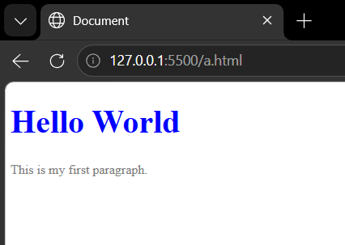
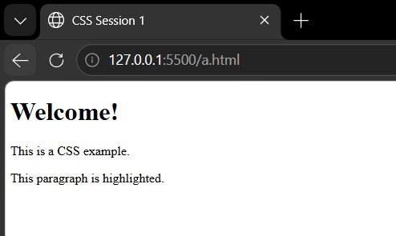
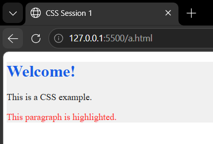

# CSS Session 1

## How CSS Works, Syntax, Selectors, Inheritance & Colors

**Prepared by:** Mohamed Abdullah
**Session:** CSS — Session 1

---

## 📑 Table of Contents

1. [How CSS Works](#1-how-css-works)
2. [CSS Syntax](#2-css-syntax)
3. [Selectors](#3-selectors)
4. [Inheritance](#4-inheritance)
5. [Colors](#5-colors)
6. [Complete Example](#6-complete-example)
7. [Practice](#7-practice)
8. [Summary](#8-summary)
9. [Recommended Resources](#9-recommended-resources)

---

# 1. How CSS Works

## What is CSS?

**CSS (Cascading Style Sheets)** is the language used to style and design HTML elements.

While HTML is responsible for the **structure and content** of a webpage, CSS controls its **appearance and layout**.

For example:

- HTML → Creates a heading.
- CSS → Changes its color, size, font, and position.

### Example

```html
<h1>Hello World</h1>
```

```css
h1 {
  color: blue;
  font-size: 40px;
}
```

The HTML creates the heading, while CSS determines how it looks.

---

## How does the browser apply CSS?

When a browser loads a webpage, it generally:

1. Reads the HTML document.
2. Builds the page structure.
3. Reads the CSS rules.
4. Matches CSS selectors with HTML elements.
5. Applies the matching styles.
6. Displays the final result on the screen.

### The basic idea

```text
HTML
 ↓
Page Structure
 ↓
CSS Rules
 ↓
Matching Selectors
 ↓
Styles Applied
 ↓
Rendered Webpage
```



---

## Ways to Add CSS

There are three common ways to add CSS to an HTML document.

### 1. Inline CSS

CSS is written directly inside the HTML element.

```html
<p style="color: red;">Hello World</p>
```

**Advantages:**

- Quick for small changes.

**Disadvantages:**

- Difficult to maintain.
- Mixes HTML with CSS.
- Not recommended for large projects.

---

### 2. Internal CSS

CSS is written inside a `<style>` element in the HTML document.

```html
<head>
  <style>
    p {
      color: blue;
    }
  </style>
</head>
```

This can be useful when styles are specific to a single HTML page.

---

### 3. External CSS

CSS is stored in a separate `.css` file.

**HTML:**

```html
<head>
  <link rel="stylesheet" href="style.css" />
</head>
```

**style.css:**

```css
p {
  color: green;
}
```

External CSS is generally the preferred approach for larger projects because it keeps the HTML and CSS separate.

---

# 2. CSS Syntax

A CSS rule consists of:

- **Selector**
- **Declaration Block**
- **Property**
- **Value**

### Basic Syntax

```css
selector {
  property: value;
}
```

### Example

```css
p {
  color: blue;
  font-size: 20px;
}
```

Here:

- `p` → Selector
- `color` → Property
- `blue` → Value
- `font-size` → Property
- `20px` → Value



---

## Multiple Declarations

A selector can contain multiple declarations.

```css
h1 {
  color: red;
  font-size: 32px;
  text-align: center;
}
```

Each declaration follows:

```text
property: value;
```

The semicolon `;` separates declarations.

---

## CSS Comments

Comments are ignored by the browser.

```css
/* This is a CSS comment */

p {
  color: blue;
}
```

Comments are useful for explaining code or temporarily disabling styles.

---

# 3. Selectors

A **CSS selector** determines which HTML elements a CSS rule should apply to.

---

## 3.1 Element Selector

Selects all elements of a specific HTML type.

```css
p {
  color: blue;
}
```

This applies to every `<p>` element.

```html
<p>First paragraph</p>
<p>Second paragraph</p>
```

Both paragraphs will become blue.

---

## 3.2 Class Selector

A class selector starts with `.`.

```css
.title {
  color: red;
}
```

HTML:

```html
<h1 class="title">Hello</h1>
```

A class can be used on multiple elements.

```html
<p class="title">Paragraph 1</p>
<p class="title">Paragraph 2</p>
```

---

## 3.3 ID Selector

An ID selector starts with `#`.

```css
#header {
  background-color: black;
}
```

HTML:

```html
<div id="header">Header</div>
```

An ID is normally intended to uniquely identify one element on a page.

---

## 3.4 Universal Selector

The universal selector `*` selects all elements.

```css
* {
  margin: 0;
  padding: 0;
}
```

This is commonly used to apply basic reset styles.

---

## 3.5 Grouping Selectors

Multiple selectors can share the same styles by separating them with commas.

```css
h1,
h2,
p {
  font-family: Arial;
}
```

This applies the same font to:

- `h1`
- `h2`
- `p`

---

## 3.6 Descendant Selector

Selects elements that are inside another element.

```css
div p {
  color: green;
}
```

This selects `<p>` elements anywhere inside a `<div>`.

```html
<div>
  <p>This paragraph is selected.</p>
</div>
```

---

## 3.7 Child Selector

The `>` symbol selects direct children only.

```css
div > p {
  color: red;
}
```

Example:

```html
<div>
  <p>This is selected.</p>

  <section>
    <p>This is NOT selected.</p>
  </section>
</div>
```

The first paragraph is a direct child of `<div>`, while the second one is not.

---

## 3.8 Attribute Selector

Attribute selectors allow us to select elements based on their attributes.

```css
input[type="text"] {
  border: 1px solid black;
}
```

HTML:

```html
<input type="text" /> <input type="password" />
```

Only the text input is selected.

---

# 4. Inheritance

**Inheritance** is a CSS mechanism where some properties applied to a parent element are passed down to its children.

### Example

```html
<div>
  <p>Hello World</p>
</div>
```

```css
div {
  color: blue;
}
```

The `<p>` will normally inherit the `color` from its parent `<div>`.

---

## Not All Properties Are Inherited

Some CSS properties are commonly inherited, such as:

- `color`
- `font-family`
- `font-size`
- `line-height`

Other properties, such as:

- `margin`
- `padding`
- `border`
- `width`
- `height`

are not normally inherited.

---

## The `inherit` Keyword

We can explicitly tell an element to inherit a property's value from its parent.

```css
.child {
  color: inherit;
}
```

Example:

```html
<div class="parent">
  <p class="child">Hello</p>
</div>
```

```css
.parent {
  color: blue;
}

.child {
  color: inherit;
}
```

The paragraph will inherit the blue color.

---

# 5. Colors

CSS provides several ways to specify colors.

---

## 5.1 Color Names

CSS supports predefined color names.

```css
p {
  color: red;
}
```

Other examples:

```css
color: blue;
color: green;
color: black;
color: white;
color: yellow;
```

---

## 5.2 HEX Colors

HEX colors use hexadecimal values.

```css
color: #ff0000;
```

The structure is:

```text
#RRGGBB
```

Where:

- `RR` → Red
- `GG` → Green
- `BB` → Blue

Examples:

```css
color: #ff0000; /* Red */
color: #00ff00; /* Green */
color: #0000ff; /* Blue */
color: #000000; /* Black */
color: #ffffff; /* White */
```

---

## 5.3 Short HEX

Some HEX colors can be written using only three characters.

```css
color: #f00;
```

This is equivalent to:

```css
color: #ff0000;
```

Another example:

```css
color: #fff;
```

is equivalent to:

```css
color: #ffffff;
```

---

## 5.4 RGB

RGB stands for:

**Red, Green, Blue**

The values range from `0` to `255`.

```css
color: rgb(255, 0, 0);
```

Examples:

```css
color: rgb(255, 0, 0); /* Red */
color: rgb(0, 255, 0); /* Green */
color: rgb(0, 0, 255); /* Blue */
color: rgb(0, 0, 0); /* Black */
color: rgb(255, 255, 255); /* White */
```

---

## 5.5 RGBA

RGBA adds an **Alpha** value to RGB.

```css
color: rgba(255, 0, 0, 0.5);
```

The alpha value controls transparency.

Examples:

```css
rgba(255, 0, 0, 1)
```

Fully visible.

```css
rgba(255, 0, 0, 0.5)
```

50% opacity.

```css
rgba(255, 0, 0, 0)
```

Fully transparent.

---

## 5.6 HSL

HSL stands for:

- **Hue**
- **Saturation**
- **Lightness**

Example:

```css
color: hsl(0, 100%, 50%);
```

HSL can make it easier to adjust the lightness or saturation of a color.



---

# 6. Complete Example

### HTML

```html
<!DOCTYPE html>
<html>
  <head>
    <title>CSS Example</title>
    <link rel="stylesheet" href="style.css" />
  </head>

  <body>
    <div class="container">
      <h1>Welcome</h1>

      <p>This is a CSS example.</p>

      <button>Click Me</button>
    </div>
  </body>
</html>
```

### CSS

```css
* {
  margin: 0;
  padding: 0;
}

.container {
  color: #333;
  text-align: center;
}

h1 {
  color: #0066ff;
  font-size: 36px;
}

p {
  color: rgb(80, 80, 80);
}

button {
  background-color: #0066ff;
  color: white;
  padding: 10px 20px;
}
```

This example combines several concepts from the session:

- Universal selector
- Class selector
- Element selector
- HEX colors
- RGB colors
- Inheritance
- CSS declarations

---

# 7. Practice

## Exercise 1 — Basic Selectors

Create an HTML page containing:

- One `<h1>`
- Two `<p>` elements
- One `<div>`
- One button

Use CSS to:

- Change the heading color.
- Change the paragraph color.
- Give the `<div>` a background color.
- Change the button text color.

---

## Exercise 2 — Classes and IDs

Create:

```html
<h1 id="main-title">My Website</h1>

<p class="description">First paragraph</p>
<p class="description">Second paragraph</p>
```

Then use CSS to:

- Style the ID.
- Style both paragraphs using the class.

---

## Exercise 3 — Colors

Create elements using:

- Color names
- HEX
- RGB
- RGBA
- HSL

Compare how each method represents a color.

---

# 8. Summary

| Topic               | Main Idea                                    |
| ------------------- | -------------------------------------------- |
| CSS                 | Controls the appearance of HTML              |
| Syntax              | `selector { property: value; }`              |
| Element Selector    | Selects HTML elements                        |
| Class Selector      | Selects elements using `.`                   |
| ID Selector         | Selects an element using `#`                 |
| Universal Selector  | Selects all elements using `*`               |
| Grouping            | Applies the same style to multiple selectors |
| Descendant Selector | Selects elements inside another element      |
| Child Selector      | Selects direct children                      |
| Attribute Selector  | Selects elements based on attributes         |
| Inheritance         | Some properties pass from parent to child    |
| HEX                 | Represents colors using hexadecimal values   |
| RGB                 | Represents colors using Red, Green, Blue     |
| RGBA                | RGB + transparency                           |
| HSL                 | Hue + Saturation + Lightness                 |

---

# 9. Recommended Resources

### MDN Web Docs

- [CSS Introduction](https://developer.mozilla.org/en-US/docs/Web/CSS)
- [CSS Syntax](https://developer.mozilla.org/en-US/docs/Web/CSS/Guides/Syntax)
- [CSS Selectors](https://developer.mozilla.org/en-US/docs/Web/CSS/Guides/Selectors)
- [CSS Inheritance](https://developer.mozilla.org/en-US/docs/Web/CSS/Guides/Inheritance)
- [CSS Colors](https://developer.mozilla.org/en-US/docs/Web/CSS/Guides/Colors)

### web.dev

- [Learn CSS](https://web.dev/learn/css/)

---

# ✅ Session Checklist

After completing this session, you should understand:

- [x] What CSS is and how it works.
- [x] The basic CSS syntax.
- [x] Element, class, ID, and universal selectors.
- [x] Grouping, descendant, child, and attribute selectors.
- [x] How CSS inheritance works.
- [x] Which properties are commonly inherited.
- [x] Different ways to represent colors.
- [x] HEX, RGB, RGBA, and HSL colors.
- [x] How to connect an external CSS file to HTML.

---

## 🎯 Mini Project

Create a simple personal profile webpage containing:

- A profile heading.
- A short description.
- A profile section.
- A button.
- Different colors.
- At least three different CSS selectors.
- An external CSS file.

Try to build the page **without copying the complete example above**.
